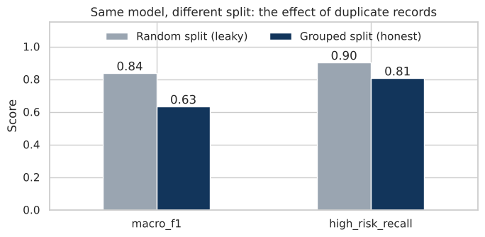
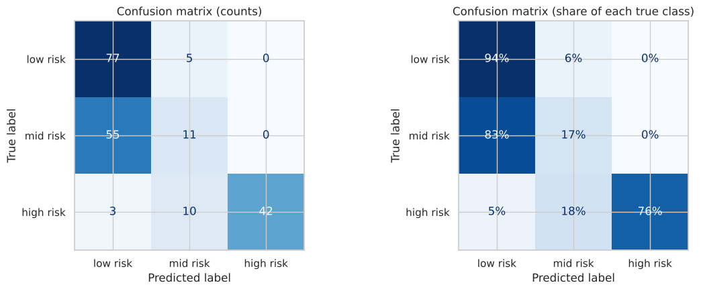
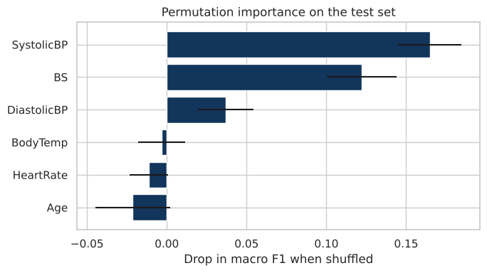

# Maternal Health Risk Prediction

A machine learning project that predicts a pregnant woman's health risk level (**low / mid / high**) from six routine vital signs, with a focus on measuring performance **honestly** on patients the model has never seen.

> I first explored this dataset in a group course project, then rebuilt it independently from scratch with a different methodology.

## Key Finding: Duplicate Records Inflate Scores

More than half of the records in this dataset (**55%**) are exact duplicates. With an ordinary random split, copies of the same record end up in both the training and test sets, so the model is partly graded on answers it has already memorized.



The same Random Forest scores a macro F1 of **0.84** with a random split, but only **0.63** when identical readings are kept on one side of the split. Every result in this project uses the grouped split, so it reflects performance on genuinely new patients.

## Dataset

[Maternal Health Risk Data Set](https://www.kaggle.com/datasets/csafrit2/maternal-health-risk-data): 1,014 records collected from hospitals and community clinics in Bangladesh.

| Feature | Description | Unit |
|---|---|---|
| Age | Age during pregnancy | years |
| SystolicBP | Upper blood pressure value | mmHg |
| DiastolicBP | Lower blood pressure value | mmHg |
| BS | Blood glucose | mmol/L |
| BodyTemp | Body temperature | °F |
| HeartRate | Resting heart rate | bpm |
| RiskLevel | Target: low (40%), mid (33%), high (27%) | |

## Methodology

1. **Data audit:** found 562 duplicate records, 35 readings with conflicting labels, and one impossible heart rate (7 bpm), which was set to missing. Extreme glucose and temperature values were **kept**, because they are real signals of high risk rather than errors.
2. **Grouped evaluation:** a held out test set of 20% of the groups, and repeated `StratifiedGroupKFold` cross validation (3 × 5 folds) for every comparison, so identical readings never cross a split.
3. **Clinical feature engineering:** pulse pressure, mean arterial pressure, and flags for hypertension (≥ 140/90), high glucose (≥ 7.8 mmol/L), fever (≥ 100.4 °F), and maternal age risk (< 18 or > 35).
4. **Model comparison:** a dummy baseline, Logistic Regression, Random Forest, and Histogram Gradient Boosting, each with and without clinical features. All preprocessing sits inside a `Pipeline`.
5. **Class imbalance experiment:** no adjustment vs class weights vs SMOTE, with SMOTE applied inside the pipeline on training folds only.
6. **Hyperparameter tuning:** randomized search with grouped cross validation.
7. **Other approaches:** six further ideas tested before touching the test set.
8. **Final evaluation, robustness check, permutation importance, and error analysis.**

## Results

**Model comparison (grouped cross validation, macro F1):**

| Model | Raw features | + Clinical features |
|---|---|---|
| Dummy baseline | 0.325 | |
| Logistic Regression | 0.618 | 0.616 |
| Random Forest | 0.634 | 0.632 |
| **Gradient Boosting** | 0.638 | **0.657** |

After tuning, Gradient Boosting with clinical features reached a cross validated **macro F1 of 0.663** and **high risk recall of 0.833**.

**Class imbalance:** class weights and SMOTE performed within one standard deviation of each other. Class weights were kept because they add no synthetic patients.

**Other approaches tried (grouped cross validation, macro F1):**

| Approach | Macro F1 |
|---|---|
| **Final model (tuned Gradient Boosting)** | **0.663** |
| Tuned decision thresholds | 0.668 |
| Soft voting ensemble (LR + RF + GB) | 0.660 |
| Ordinal model | 0.648 |
| Ordinal + monotonic constraints | 0.643 |
| Inverse group weights | 0.638 |
| Extra Trees | 0.613 |

No approach meaningfully improved on the final model: the small gain from tuned thresholds is far below one standard deviation (± 0.028) and comes with lower high risk recall. The limiting factor is the data rather than the algorithm, since low and mid risk overlap on every vital sign.

**Held out test set:**

| Metric | Score |
|---|---|
| Macro F1 | 0.605 |
| Macro F1 on unique test readings | 0.664 |
| High risk recall | 0.764 |
| High risk precision | 1.000 |
| ROC AUC (one vs rest, macro) | 0.812 |



- **High risk is handled well:** every patient flagged as high risk truly was, and about three quarters of high risk patients were caught.
- **Mid risk is the weak spot:** most mid risk patients were predicted as low risk. A single reading with completely normal vital signs, repeated 34 times in the test set and labeled mid risk 27 times, accounts for many of these errors. On unique test readings, the score matches the cross validation estimate.

**What drives the predictions:**



Systolic blood pressure and blood glucose dominate, which matches clinical knowledge. Body temperature contributes almost nothing, and the high risk patients the model predicted as low risk all had a fever with otherwise normal readings, so fever is a clear area for improvement.

## Limitations

- The dataset is small (about 400 unique readings) and comes from a single region.
- Some identical readings carry different labels, which caps achievable accuracy at about 92%.
- Only six vital signs are available; medical history and lab tests are missing.
- **This is an educational project, not a clinical tool.**

## Tech Stack

Python · pandas · NumPy · scikit-learn · imbalanced-learn · Matplotlib · Seaborn

## Running the Project

```bash
git clone https://github.com/Ghadah-Almaawy/maternal-health-risk-prediction.git
cd maternal-health-risk-prediction
pip install -r requirements.txt
```

Download `Maternal Health Risk Data Set.csv` from [Kaggle](https://www.kaggle.com/datasets/csafrit2/maternal-health-risk-data) into the project folder, then:

```bash
jupyter notebook maternal_health_risk_classification.ipynb
```

## Repository Structure

```
├── maternal_health_risk_classification.ipynb   # full analysis
├── leakage.png, confusion_matrix.png,          # charts used in this README
│   feature_importance.png
└── requirements.txt
```

## License

This project is shared for educational and portfolio purposes.
